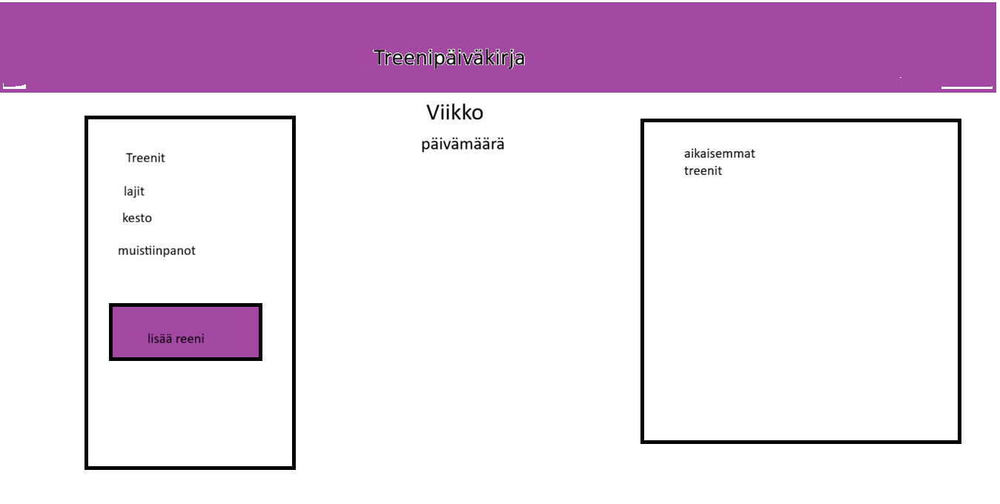

# Treenipäiväkirja

**Tekijä:** Arttu Laine

## Projektisuunnitelma

### Projektin idea

Treenipäiväkirja on selaimessa toimiva sovellus, johon käyttäjä voi kirjata viikon aikana tekemänsä treenit. Sovellus laskee, kuinka paljon aikaa treenaamiseen on kulunut yhteensä ja miten aika jakautuu eri lajien kesken. Sovellus on tarkoitettu kenelle tahansa, joka haluaa pitää kirjaa omasta liikunnastaan.

### Suunnitellut toiminnot

* Treenin lisääminen lomakkeella: päivämäärä, laji (alasvetovalikko), kesto minuutteina, rasitustaso (valintanapit) ja vapaat muistiinpanot
* Lomakkeen tarkistus: tyhjät kentät, kesto 1–600 minuuttia, päivämäärä ei voi olla tulevaisuudessa, muistiinpanokenttä enintään 100 merkkiä. Virheestä näytetään ilmoitus ja kenttä korostetaan punaisella reunalla.
* Lista kirjatuista treeneistä ja mahdollisuus poistaa treeni
* Viikkonäkymä: lista ja yhteenveto näyttävät valitun viikon, viikkoja selataan nuolinapeilla
* Yhteenveto: viikon kokonaisaika sekä aika ja prosenttiosuus lajeittain
* Visualisointi: vaakapylväät lajeittain pelkällä CSS:llä
* Elementtien piilotus ja näyttäminen: treenilistan suodatus lajin mukaan ja yhteenvedon avaus/sulku
* Tietojen tallennus selaimen localStorageen
* Tumma ja vaalea tila nappi muuttaa sovelluksen ulkoasua.

### luonnos

## Verkkolinkit

* Julkaistu sovellus:(https://arbertos.github.io/projekti-1/)
* GitHub-repositorio:(https://github.com/arbertos/projekti-1)
* Projektin videoesittely: [Lisää tähän videon osoite](https://example.com/)

## Tietoja sovelluksesta

Treenipäiväkirja on verkkosovellus, jolla voi pitää kirjaa omista treeneistään. Käyttäjä kirjaa lomakkeella treenin päivämäärän, lajin, keston, rasitustason ja halutessaan lyhyet muistiinpanot. Sovellus tarkistaa syötteet ennen tallennusta ja näyttää virheellisen kentän punaisella reunalla ja virheilmoituksella.

Sovellus näyttää kerrallaan yhden viikon (maanantaista sunnuntaihin), ja viikkoja voi selata nuolinapeilla. Otsikossa näkyy viikkonumero ja päivämäärät. Sovellus näyttää kerrallaan yhden viikon (maanantaista sunnuntaihin) viikkonumeroineen, ja viikkoja voi selata nuolinapeilla. Kirjatut treenit näkyvät listassa uusin ensin, ja rasitustaso näkyy rivin reunan värinä (vihreä = kevyt, oranssi = keskitaso, punainen = raskas). Listaa voi suodattaa lajin mukaan, ja treenejä voi poistaa. Yhteenveto näyttää treenien kokonaisajan sekä ajan ja prosenttiosuuden lajeittain pylväinä. Yhteenvedon voi piilottaa ja tuoda takaisin napista. Tiedot tallentuvat selaimen localStorageen, joten ne säilyvät sivun päivityksen jälkeen.

### Teknologiat

* HTML – sivun rakenne
* CSS – ulkoasu ja asettelu
* JavaScript – toiminnallisuus, DOM-skriptaus ja lomakkeiden validointi
* localStorage – tietojen tallentaminen selaimeen

### Sovelluksen käyttö

1. Avaa julkaistu sovellus yllä olevasta linkistä.
2. Täytä lomake: päivämäärä, laji, kesto minuutteina ja rasitustaso. Muistiinpanot ovat vapaaehtoisia.
3. Paina **Lisää treeni**. Jos jokin kenttä on virheellinen, se korostuu punaisella ja alle tulee ohje.
4. Treeni ilmestyy listaan ja yhteenveto päivittyy. Näkymä siirtyy sille viikolle, jolle treeni kirjattiin.
5. Selaa viikkoja yläosan nuolinapeista. Tuleville viikoille ei voi siirtyä.
6. Valitse **Näytä**-valikosta laji, jos haluat nähdä vain sen lajin treenit.
7. Poista treeni rivin **Poista**-napista.
8. Piilota tai näytä yhteenveto sen oikean yläkulman napista.
9. Päivitä sivu: treenit säilyvät, sillä ne on tallennettu selaimeen.

## Kuvakaappaukset

## Tunnetut virheet / puutteet

* Kirjattua treeniä ei voi muokata, vain poistaa ja lisätä uudelleen.
* Tiedot tallentuvat vain kyseiseen selaimeen, eivätkä ne siirry toiselle laitteelle.

## Oma arvio ja oppimisen reflektointi

* Missä onnistuin?
* Mikä oli haastavaa?
* Mitä parantaisin, jos aikaa olisi enemmän?
* Mitä opin HTML:stä, CSS:stä, JavaScriptistä ja DOM-skriptauksesta?
* Mikä jäi epäselväksi tai mistä haluaisin oppia lisää?
* Oma arvio projektista: xx/10 pistettä

## Lähteet ja kiitokset

* [Lähteen tai tutoriaalin nimi](https://example.com/)
* Käytetty tekoälytyökalu: Claude (Anthropic)
  * Miten työkalua käytettiin: ...

## Lisenssi

Tämä projekti on lisensoitu MIT-lisenssillä.